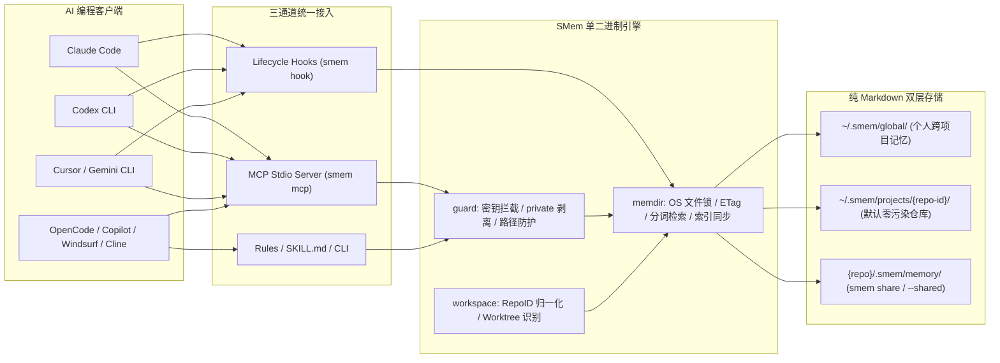

<div align="center">

# SMem

**通用 AI 编程 Agent 统一记忆底座 · Local-First Cross-Agent Memory Layer**

[](https://go.dev/)
[](#核心特性)
[](https://github.com/evepupil/SMem)
[](#mcp-接口规范)
[](#快速开始)
[](LICENSE)

让 **Claude Code、Codex CLI、Cursor、Gemini CLI、OpenCode、GitHub Copilot、Windsurf、Cline / Roo Code** 等所有 AI 编程工具共同读写同一份纯 Markdown 记忆。

[快速开始](#快速开始) · [核心特性](#核心特性) · [架构与原理](#架构与原理) · [工具适配矩阵](#主流工具适配矩阵) · [CLI 与 MCP 手册](#cli-命令参考) · [安全与并发](#安全并发与自愈机制)

</div>

---

## 为什么需要 SMem？

日常开发中，开发者经常在多个 AI 编程助手之间切换（例如用 Claude Code 做架构重构、Codex CLI 跑批处理修复、Cursor 做精细编辑、Gemini CLI 做代码审查），但各家的“记忆”相互割裂：

- **记忆孤岛**：在 Claude Code 里反复纠正过的部署规范或个人习惯，切到 Codex CLI 或 Cursor 后全部失忆，不得不一遍遍重复交代。
- **格式私有且不透明**：有的工具将记忆埋在后台队列或私有目录中，既不方便人工审查编辑，也无法在工作流间即时同步。
- **过重的替代方案**：许多记忆中间件要求引入 SQLite、向量数据库或常驻后台服务，反而带来进程维护成本、索引不同步风险和项目仓库污染。

**SMem 的解法**：以经过生产验证的 **Claude Code 原生记忆格式**（`MEMORY.md` 入口索引 + 3 字段 Frontmatter 主题 Markdown + 4 分类纪律）作为开放标准，打包为一个 **零依赖、单一静态 Go 二进制**，通过 **MCP Server + Lifecycle Hooks + Agent Skills/Rules + CLI** 让所有主流 AI 编程助手透明共享同一套 Markdown 文件。

---

## 核心特性

- **纯 Markdown 真相源（零数据库 · 零向量库 · 零常驻进程）**
  没有 SQLite，没有 Embedding 服务，没有后台守护进程。每个记忆作用域只是一个包含 `MEMORY.md` 与主题 `.md` 文件的目录——人工打开编辑、Claude 原生工具写入、`git pull` 或 SMem MCP/CLI 修改后**立即互见**。
- **单一静态 Go 二进制（纯标准库，冷启动 < 5ms）**
  基于 Go 1.25 标准库编写，零第三方依赖，跨平台支持 Windows / macOS / Linux。生命周期 Hook 采用确定性逻辑（不调用 LLM），Fail-open 设计绝不阻塞主会话。
- **2 层清晰作用域 + Git Worktree 自动共享**
  - `project`：默认存储于 `~/.smem/projects/<repo-id>/`（按 Git `origin` URL 归一化或主仓库路径生成的稳定指纹），**默认零污染项目 Git 状态**，同一仓库的多个 Git Worktree 自动共享同一份记忆。
  - `global`：存储于 `~/.smem/global/`，保存跨项目的个人画像与通用工作习惯，目录本身可作为私有 Git 仓库通过 `smem sync` 跨设备同步。
- **Claude Code 原生零损耗协同**
  - 默认采用 `native` 模式：通过 `.claude/settings.local.json` 的 `autoMemoryDirectory` 直连 SMem 项目目录（自动加入 `.git/info/exclude`），100% 保留 Claude Code 原生自动记忆、`extractMemories` 与 `/dream`，同时由 Hook 补齐 `global` 全局偏好；
  - 也支持 `--claude-mode managed` 模式，将 Claude Code 与其他工具统一收口到同一条 MCP 写入管线。
- **三通道防遗忘接入**
  - **5 工具精简 MCP Server**：`memory_index` / `memory_read` / `memory_write` / `memory_delete` / `memory_search`，外加实时索引 Resource（`smem://index`）与四阶段整理 Prompt（`dream`）。
  - **超轻量 Lifecycle Hooks**：会话启动 / 上下文压缩恢复时自动注入 `MEMORY.md` 索引并内联紧凑的 `global` 偏好（≤ 10 条且总计 ≤ 2KB），让个人习惯在首轮对话即生效；提交提示词时确定性识别“记住/以后都…”或“忘掉/改成…”意图（自动排除“这一次/临时用”等一次性指令），并在索引超限时补召回相关条目。
  - **开放规则与技能兜底**：自动维护 `AGENTS.md`、`GEMINI.md` 及开放标准 `SKILL.md`，在无 Hook 或无 MCP 的客户端中也能稳定使用。
- **生产级安全与并发护栏**
  - **密钥拦截**：写入与共享推送前确定性扫描 11 类常见凭证模式并拒绝落盘，同时自动剥离 `<private>...</private>` 片段。
  - **并发控制**：跨平台 OS 独占文件锁（Unix `flock` / Windows `LockFileEx`）+ 同目录 `fsync` 原子替换 + 12 位 SHA-256 `etag` 乐观并发校验。
  - **防陈旧与索引自愈**：读取时附带 `memoryAge`（`today` / `yesterday` / `N days ago`）核对提醒；`MEMORY.md` 严格控制 200 行 / 25KB 上限且非静默提示；自动发现未登记的主题文件。

---

## 架构与原理



### 目录与文件格式

每个记忆作用域目录采用扁平的 Claude Code 兼容结构：

```text
<memory-dir>/
├── MEMORY.md                     # 自动维护的入口索引（硬控 ≤ 200 行 / 25KB）
├── user_backend_profile.md       # 个人背景与沟通偏好 (global)
├── feedback_terse_output.md      # 纠错与工作流纪律
├── project_release_owner.md      # 项目决策与约束
└── reference_ops_dashboard.md    # 外部看板/工单系统指针
```

每条主题文件为 UTF-8 Markdown，包含 3 个标准 YAML Frontmatter 字段（也兼容读取人类手写的无 Frontmatter 普通 `.md` 文件，以及 Claude Code 2.1+ 的嵌套 `metadata:` 块）：

```markdown
---
name: 生产发版审批人约定
description: 涉及生产环境发布、上线交接单或部署审批流程时触发
type: project
---

本项目每次生产发版前必须由小周审批放行，再执行 `scripts/deploy.sh`。

**Why:** 2026-11-23 起由小周接替原负责人把关 checkout 服务生产发布。
**How to apply:** 准备上线交接单或部署步骤时，固定填写小周为放行人。
```

---

## 快速开始

### 1. 安装（需 Go 1.25+）

```sh
git clone https://github.com/evepupil/SMem.git
cd SMem
go install ./cmd/smem
```

或从仓库源码直接编译单文件可执行程序：

```sh
# macOS / Linux
go build -o bin/smem ./cmd/smem

# Windows (PowerShell)
go build -o bin/smem.exe ./cmd/smem
```

> 请确保 `smem` 所在目录（如 `$GOPATH/bin`）已加入系统 `PATH`。

### 2. 一键接入本机 AI 编程工具

在你的 Git 项目根目录中，建议先用 `--dry-run` 预览配置改动，再正式应用：

```sh
# 预览即将修改的配置文件（不写入磁盘）
smem setup --dry-run

# 自动探测本机已安装工具并安全接入
smem setup

# 查看各工具的探测与接入状态
smem setup --status
```

常用接入选项：

| 选项 | 说明 |
| --- | --- |
| `--agents auto \| all \| <列表>` | 默认 `auto` 自动探测（未探测到时默认接入 `claude,codex`）；也可显式指定如 `--agents claude,codex,cursor,gemini,opencode` |
| `--claude-mode native \| managed` | 默认 `native`（配置 `autoMemoryDirectory` 原生直连）；传入 `managed` 则禁用 Claude 原生 Auto Memory，统一经由 SMem MCP 管线 |
| `--shared` | 在当前仓库创建 `.smem/.shared` 标记，直接绑定项目记忆到 `<repo>/.smem/memory/` 随仓库共享 |
| `--project-rules` | 额外在项目根目录生成通用 `AGENTS.md` 与 `.agents/skills/smem/SKILL.md`（默认关闭，保持团队仓库 `git status` 干净） |
| `--bin <路径>` | 显式指定写入工具配置的 `smem` 可执行文件路径 |
| `--remove` | 安全移除 SMem 注入的 MCP、Hook 与规则块（**保留所有记忆文件**） |

> **安全承诺**：首次修改任何外部配置文件前，SMem 会自动将原文件备份至 `~/.smem/backups/`。JSON/JSONC 解析保留其余键，TOML 采用 `# smem:start` / `# smem:end` 注释块维护，Markdown 采用 `<!-- smem:start -->` / `<!-- smem:end -->` 块维护。

### 3. 导入既有原生记忆（可选）

如果你此前已经在 Claude Code、Codex CLI 或 Cline 中积累了原生记忆，可一键预览并迁移进 SMem（自动执行密钥扫描与 `<private>` 剥离）：

```sh
smem import --from claude --dry-run
smem import --from claude

# 其他来源
smem import --from codex --scope global
smem import --from cline
smem import --from dir --path ./notes --scope project
```

### 4. 日常跨工具接力示例

接入完成并重启 AI 客户端会话后，无需记忆任何命令，直接用自然语言交互即可：

1. **在 Claude Code 中沉淀规范**：
   > “记住：以后这个项目每次生产发版前必须由小周放行。”
   → 自动写入 `project` 作用域，更新 `MEMORY.md`。
2. **切换到 Codex CLI / Cursor / Gemini CLI**：
   → 新会话启动时自动读取同一份 `MEMORY.md` 与已生效的 `global` 偏好；同一仓库新建的 Git Worktree 也自动共享该记忆。
3. **随项目演进更正或遗忘**：
   > “忘掉之前那条发版放行人的记忆，以后改为走 CI 自动审批。”
   → Agent 先读取最新 `etag`，原位更新正文为**现行唯一真相**（不把淘汰旧值留在正文中污染检索）或携带 `etag` 安全删除。

---

## 主流工具适配矩阵

以下配置路径与行为均与当前源码实现（`internal/adapters/setup.go`）严格对应：

| 工具 | `--agents` 标识 | MCP 注册位置 | Hook 接入位置 | 规则 / Skill 入口 | 原生导入 (`smem import`) |
| --- | --- | --- | --- | --- | --- |
| **Claude Code** | `claude` | `~/.claude.json` (`mcpServers.smem`) | `~/.claude/settings.json` (`SessionStart`, `UserPromptSubmit`, `PostCompact`)；项目级 `.claude/settings.local.json` (`autoMemoryDirectory` / `autoMemoryEnabled`) | `~/.claude/skills/smem/SKILL.md` | `--from claude`（扫描 `~/.claude/projects/<slug>/memory/`） |
| **Codex CLI** | `codex` | `$CODEX_HOME/config.toml` (`[mcp_servers.smem]`，含 `env_vars = ["SMEM_HOME"]`) | `$CODEX_HOME/hooks.json` (`SessionStart`, `UserPromptSubmit`) | `$CODEX_HOME/AGENTS.md`（存在非空 `AGENTS.override.md` 时优先写入它）+ `$CODEX_HOME/skills/smem/SKILL.md` | `--from codex`（扫描 `$CODEX_HOME/memories_v2/` 或 `memories/`） |
| **Cursor** | `cursor` | `~/.cursor/mcp.json` (`mcpServers.smem`) | `~/.cursor/hooks.json` (`sessionStart`, `beforeSubmitPrompt`) | 可配合 `--project-rules` | `--from dir --path <目录>` |
| **Gemini CLI** | `gemini` | `~/.gemini/settings.json` (`mcpServers.smem`) | `~/.gemini/settings.json` (`BeforeAgent`) | `~/.gemini/GEMINI.md` | `--from dir --path <目录>` |
| **OpenCode** | `opencode` | `~/.config/opencode/opencode.json` (`mcp.smem`, `type: "local"`) | — | `~/.config/opencode/AGENTS.md` | `--from dir --path <目录>` |
| **GitHub Copilot** | `copilot` | `~/.copilot/mcp-config.json` (`mcpServers.smem`) | — | `--project-rules` 时写入 `.github/copilot-instructions.md` | `--from dir --path <目录>` |
| **Windsurf** | `windsurf` | `~/.codeium/windsurf/mcp_config.json` (`mcpServers.smem`) | — | 可配合 `--project-rules` | `--from dir --path <目录>` |
| **Cline / Roo Code** | `cline` | `<repo>/.roo/mcp.json` (`mcpServers.smem`) | — | 可配合 `--project-rules` | `--from cline`（扫描 `<repo>/memory-bank/`） |
| **通用客户端（Antigravity / Aider 等）** | — | 在客户端配置 stdio MCP：`command: "smem"`, `args: ["mcp"]` | — | `--project-rules` 生成项目根 `AGENTS.md` + `.agents/skills/smem/SKILL.md` | `--from dir --path <目录>` |

---

## 记忆规范与类型系统

### 两种作用域与四种类型

| `type` | 适用内容 | 推荐作用域 | 写作约束 |
| --- | --- | --- | --- |
| `user` | 开发者角色、技术栈背景、语言与回复风格偏好 | `global` | 客观记录事实，不臆测 |
| `feedback` | 纠错与已确认的工作原则（“别这样 / 以后都这样”） | 跨项目进 `global`，单项目进 `project` | 建议包含 `**Why:**` 与 `**How to apply:**` |
| `project` | 代码与 Git 历史无法推导的业务决策、审批人、环境坑点 | `project` | 相对时间必须转为绝对日期（如 `2026-11-23`） |
| `reference` | 外部看板、监控、文档库、工单系统等位置指针 | `project`（个人通用进 `global`） | 写清系统用途与入口，严禁存凭证 |

### 高信噪比纪律（明确“不记什么”）

- 不记代码或 `git log` 可直接查到的目录结构、函数实现或配置值。
- 不记一次性要求（如“这一次先用 npm”）与临时排障栈信息。
- 不重复记录已写入 `CLAUDE.md` / `AGENTS.md` 的静态规则。
- **严禁记录任何 API Key、Token、私钥、密码与敏感个人资料**。

---

## MCP 接口规范

`smem mcp` 启动零依赖 JSON-RPC 2.0 stdio 服务（兼容协议版本 `2024-11-05`、`2025-03-26`、`2025-06-18`）：

### Tools（5 个核心工具）

| 工具名 | 参数 | 行为说明 |
| --- | --- | --- |
| `memory_index` | `scope?` (`all`\|`project`\|`global`), `include_manifest?` | 返回全局与项目 `MEMORY.md` 合并索引（含自动发现的未索引条目），可选附带 `type`/`age`/`etag` 清单 |
| `memory_read` | `scope` (`project`\|`global`), `files` (`1..5` 个文件名) | 批量读取主题正文、12 位 SHA-256 `etag`、相对年龄 `age` 及超过 1 天的保鲜核对提醒 |
| `memory_write` | `type`, `name`, `description`, `content`, `scope?`, `file?`, `etag?` | 新建或原位更新记忆并原子更新 `MEMORY.md`。更新已有文件需传最新 `etag`；若自动生成的标题变化，会自动迁移文件名避免旧值残留 |
| `memory_delete` | `scope`, `file`, `etag` | 校验最新 `etag` 后删除主题文件并从 `MEMORY.md` 移除索引行 |
| `memory_search` | `query`, `scope?`, `type?`, `limit?` (`1..20`) | 纯 Go 内存全文检索，支持中英文混合、中文二元切分（bigrams）与 `camelCase` / `snake_case` 代码标识符分词 |

### Resource & Prompt

- **Resource `smem://index`** (`text/markdown`)：实时返回合并后的全局与项目 `MEMORY.md` 索引视图。
- **Prompt `dream`** (`scope?`)：输出对标 Claude Code `autoDream` 的四阶段整理指令（`Orient` → `Gather` → `Consolidate` → `Prune & Index`），并附带当前工作区体检摘要。

---

## CLI 命令参考

所有读写与检索类命令均支持 `--json` 机器可读输出：

```sh
# 索引与体检
smem index [--scope all|project|global] [--manifest] [--rebuild] [--json]
smem check [--scope all|project|global] [--fix] [--json]
smem dream [--scope all|project|global]

# 读写查删
smem read [--scope project|global] [--json] <file> [file...]
smem write [--scope project|global] --type user|feedback|project|reference --name "标题" \
           [--desc "触发条件"] [--file 文件名 --etag 校验码] [--stdin] [--allow-secret] [--json] "正文"
smem delete [--scope project|global] --etag <etag> [--json] <file>
smem search [--scope all|project|global] [--type ...] [--limit 8] [--json] <关键词...>

# 团队选择性共享（本机项目目录 <-> 仓库 .smem/memory/）
smem share status [--json]
smem share push [--all] [--dry-run] [--json] [file...]
smem share pull [--all] [--force] [--dry-run] [--json] [file...]

# 个人全局记忆私有 Git 同步（~/.smem/global/）
smem sync [--remote <私有Git仓库URL>]

# 工具接入、导入与协议入口
smem setup [--dry-run] [--agents ...] [--claude-mode native|managed] [--shared] [--project-rules] [--status] [--remove] [--json]
smem import --from claude|codex|cline|dir [--path 目录] [--scope project|global] [--dry-run] [--json]
smem mcp
smem hook <claude|codex|cursor|gemini> <session-start|prompt-submit|post-compact|before-agent> [--claude-mode native|managed]
smem version
```

### 环境变量

| 变量 | 默认值 | 用途 |
| --- | --- | --- |
| `SMEM_HOME` | `~/.smem` | 覆盖 SMem 根目录（`global/`、`projects/`、`backups/` 均位于此目录下） |
| `CODEX_HOME` | `~/.codex` | 识别 Codex CLI 配置目录（写入 `config.toml`、`hooks.json`、`AGENTS.md` 与导入原生记忆） |

---

## 安全、并发与自愈机制

- **确定性密钥守卫（`internal/guard`）**：默认拦截 11 类高置信度凭证格式——Private Key 头、Anthropic Key（`sk-ant-...`）、OpenAI Key（`sk-...`）、GitHub Token（`ghp_`/`gho_`/`ghu_`/`ghs_`/`ghr_`）与 Fine-grained PAT（`github_pat_`）、AWS Access Key（`AKIA`/`ASIA`）、Google API Key（`AIza...`）、Slack Token（`xox...`）、Stripe Live Key（`sk_live_`/`rk_live_`）、JWT Token 以及带密码的数据库/消息队列连接 URI（PostgreSQL/MySQL/MongoDB/Redis/AMQP）。MCP 模式不可绕过；CLI 仅允许显式传 `--allow-secret` 跳过。
- **`<private>` 片段剥离与路径隔离**：持久化与导入前自动清除 `<private>...</private>` 内容；强制校验单层 `.md` 文件名（禁止 `MEMORY.md` 覆盖与路径分隔符）并逐级 `Lstat` 拒绝通过符号链接目录写入。
- **跨平台锁与乐观并发**：目录写锁在 Unix 上使用 `flock`，在 Windows 上调用 `kernel32.dll` 的 `LockFileEx`，配合同目录临时文件 `fsync` + 原子重命名（Windows 带退避重试）。更新或删除必须携带匹配读取时的 `etag`，检测到外部修改即拒绝盲写。
- **非静默超限与索引自愈**：`MEMORY.md` 达到 200 行或 25KB 时不会静默丢弃底部条目，而是在索引末尾输出显式截断提示，并在 `UserPromptSubmit` / `BeforeAgent` Hook 中自动对超限词条做补充检索；同时 `memory_index` 与 `smem check --fix` 可自动识别并修复直接放入目录的未索引 `.md` 文件或悬空链接。

---

## 仓库结构与开发测试

```text
SMem/
├── cmd/smem/            # CLI 入口与多进程端到端测试 (e2e_test.go)
├── internal/
│   ├── workspace/       # Git Repo / Worktree 指纹计算与双层作用域解析
│   ├── guard/           # 密钥检测、<private> 剥离与路径/符号链接防护
│   ├── memdir/          # Frontmatter 编解码、原子写入、OS 文件锁、ETag、检索与体检
│   ├── mcp/             # 零依赖 JSON-RPC 2.0 MCP Stdio Server 与 Dream 协议
│   ├── hooks/           # Claude / Codex / Cursor / Gemini 统一 Hook 路由与意图识别
│   ├── adapters/        # 多客户端自动探测、配置原子补丁、迁移导入与 Share/Sync
│   └── cli/             # 人类与脚本 CLI 命令实现
├── docs/                # 架构设计、格式规范、工具适配与原生记忆调研文档
└── scripts/check.ps1    # Windows 一键验收脚本
```

### 运行测试与验收门禁

```sh
go vet ./...
go test ./...
go test -race ./...
```

Windows PowerShell 可直接执行内置检查脚本（含 `go vet`、全量单测、编译构建与烟雾测试）：

```powershell
.\scripts\check.ps1
```

---

## 延伸阅读

- [架构设计](docs/架构设计.md)
- [记忆格式与行为规范](docs/格式规范.md)
- [主流 AI 编程工具适配矩阵](docs/工具适配.md)
- [主流编程助手的原生记忆调研](docs/调研/主流编程助手的记忆.md)

## 参与贡献

欢迎通过 Issue 或 Pull Request 参与改进：

1. Fork 本仓库并创建特性分支（`git checkout -b feat/your-feature`）。
2. 新增功能或适配新工具时，请补充对应的单元测试并确保 `go vet ./...` 与 `go test ./...` 全部通过。
3. 提交清晰的变更说明并发起 Pull Request。

## 开源协议

本项目基于 [MIT License](LICENSE) 开源。
